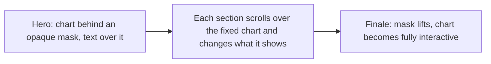

# vroom marketing site: design brief

The homepage for vroom, plus a route into the docs. This brief is the input for
image-model mockups and the source of truth for the HTML mockup built from them.
When a mockup and this brief disagree, the brief wins.

**Chosen direction: B (signal green, centered hero).** Reference frames live in
`design/directions/`:

| Frame | File |
|---|---|
| Hero, desktop | `vroom-b-01-hero.jpg` |
| Hero, phone | `vroom-b-01-hero-phone.jpg` |
| 04 Indicators | `vroom-b-02-indicators.jpg` |
| 09 Mobile | `vroom-b-09-mobile.jpg` |
| 10 Finale | `vroom-b-10-finale.jpg` |

Known image-model errors to ignore: garbled price-axis numbers, the stray cloud
doodle in the indicators frame, "Compiled" instead of "Computed" in its body copy,
and the scrambled OHLC readout in the finale. The real chart and the copy in this
brief replace all of them.

## 1. Goal and audience

**Who it is for.** React and React Native developers building trading, crypto, or
finance apps. Second reader: the tech lead comparing vroom with lightweight-charts,
victory-native, or wagmi-charts.

**What the page has to do.** Prove vroom is fast by letting the visitor watch it,
then feel it. Every section ends one click from the Quickstart or GitHub.

**Core message.**
- One C++ core, drawn with Skia, runs on every platform.
- 60+ FPS pan, pinch, and zoom that feels native on a phone and in a browser.
- The same props and types on React Native and the web.
- No toolbars or menus ship with the chart. Your app owns the UI around it, so
  the chart looks like your product.

**Voice.** Confident, short, technical. Claims come with numbers. No exclamation
marks, no "revolutionary", no "seamless".

## 2. Visual language

Adapted from [claudia.gallery](https://claudia.gallery/): a dark, editorial,
instrument-panel feel where data is the decoration.

**Color**
- Background: near-black, about `#0B0B0C`, with slightly lighter panels (`#121214`).
- Text: warm off-white, about `#ECE9E2`. Secondary text at 60% of that.
- One accent: signal green `#3DDC84` (direction B, chosen). Use it only for the
  live dot, positive change, the current-price tag, viewfinder brackets, and the
  active row in a spec table. Never introduce a second accent.
- Candles are grayscale: up candles gray-white (about `#D8D6D0`), down candles dim
  gray (about `#5A5A5E`), volume bars very dark gray. The chart stays monochrome so
  the green is the only color on the page.

**Type, three voices**
- Display: a condensed, heavy DIN-style face (weight 900), set very large: about
  104px on desktop for section titles. Tight tracking, all caps or title case.
- Wordmark: `VROOM` set in split-flap tiles, one dark rounded tile per letter with a
  hairline split across the middle, like a departures board. The tiles can flip
  once on load.
- Labels: small monospace caps (IBM Plex Mono style), 11 to 12px with wide
  tracking, for the nav, section numbers, prices, stats, and captions.
- Body: a neutral grotesk at 16 to 18px.

**Structure**
- Spec tables: thin 1px rules, a numbered monospace label column on the left
  (`01 GESTURES`), and plain text on the right. Used in place of feature cards.
- Viewfinder marks: thin corner brackets around things the page points at. On the
  chart, a bracket around the newest candle with a readout such as
  `BTC-PERP · 1M · 97,412.5`, echoing the reference's face-detection boxes.
- Section counters: `03 / 10` in monospace at the top of each section.
- Generous negative space and a 12-column grid. Text blocks max out around 560px.

**Never**
- Purple or blue gradient washes, glassmorphism, emoji icons.
- Three identical feature cards in a row.
- Stock photos, 3D blobs, or illustrations of charts. The only chart is the real one.

## 3. Signature interaction: the fixed chart



- One live vroom chart (`@vroomchart/react`) fills the viewport as a fixed layer
  behind the page. All content scrolls over it; the chart never scrolls away.
- A mask sits between the chart and the text: a near-black gradient, heaviest
  behind the text column and lightest over the right edge of the chart. In the
  hero it is about 75% opaque behind the text. It thins section by section, so the
  chart keeps getting clearer.
- Each section owns a chart state. When a section crosses the middle of the
  viewport, the page sets that state through existing props, and vroom's own
  transitions animate the change:
  - framing: `visibleRange`, `defaultCandleWidth`
  - indicators: `rsi`, `macd`, `atr`, `movingAverages`, `vwap`, `bollingerBands`,
    `ichimoku`, `fairValueGaps`, `volume`
  - annotations: `drawings`, `priceLines`, `footprints`, `liquidity`
  - look: `theme`, `chartType`, `priceScaleMode`
  - motion: `transitionMs`, `streamTransition="transform"` for live ticks
- Until the finale, the chart ignores input. There is no prop for this, so the chart
  wrapper uses `pointer-events: none` and turns it back on at the finale. Page
  scrolling must never be captured by the chart's wheel zoom.
- At the finale the mask lifts completely, the text steps aside, and a monospace
  hint appears: `DRAG · PINCH · SCROLL TO ZOOM`. The full chart is playable.
- When the visitor's system asks for reduced motion, set `reduceMotion` on the
  chart and swap section states instantly. The mask still thins, without animating.

## 4. Live data

- History comes from Hyperliquid's free public API. No key or account needed.
  - `POST https://api.hyperliquid.xyz/info`
  - Body: `{ "type": "candleSnapshot", "req": { "coin": "BTC", "interval": "1m", "startTime": <ms>, "endTime": <ms> } }`
  - Returns up to the 5,000 most recent candles. Supported intervals run from
    `1m` to `1M`.
- New candles stream over `wss://api.hyperliquid.xyz/ws` with a `candle`
  subscription for `BTC` and `1m`. Each update replaces or appends the last candle,
  and the chart eases it in with `streamTransition`.
- The hero readout shows the live price, with a small pulsing accent dot labeled
  `LIVE · HYPERLIQUID BTC-PERP`.
- Fallback: ship a recent snapshot with the page. Render it immediately, then swap
  in live data when it arrives. If the socket drops, the dot turns gray and reads
  `DELAYED`. The page never shows an empty chart or a spinner.

## 5. Navigation

- A slim bar fixed to the top, about 48px tall, on a translucent near-black
  background with a 1px rule underneath.
- Left: the split-flap `VROOM` mark, small.
- Right, in monospace caps: `DOCS`, `QUICKSTART`, `API`, `AGENTS`, `GITHUB`.
- Far right: a copy button showing `npm i @vroomchart/react`. On click it reads
  `COPIED` for 1.5s.
- On phones the links collapse into a `MENU` button that opens a full-screen
  list in the same monospace style.
- The docs stay on Docusaurus (`docs/`, currently deployed at
  `vroom-docs.vercel.app`) and get a light restyle later to match this site: same
  colors, monospace nav, condensed headings.

**Open decision:** whether the marketing site is a separate app that links to the
docs, or custom pages inside the Docusaurus site.

## 6. Homepage sections, in scroll order

Each section has a counter, a headline, a short paragraph, a spec table where
noted, and the chart state behind it. Copy is a draft for the mockup.

**01 Hero**
- Headline: `VROOM` in split-flap tiles, then "Charts that keep up."
- Body: "Candlestick charts drawn by one C++ core, at 60+ FPS, on React Native and
  the web."
- CTAs: `READ THE DOCS` (filled off-white) and `GITHUB` (outlined).
- Bottom-right readout: live BTC price, 24h change, `LIVE · HYPERLIQUID BTC-PERP`.
- Chart: about 120 recent 1m candles, volume on, viewfinder bracket on the newest
  candle.

**02 Speed**
- Headline: "Sixty frames, every gesture."
- Body: "Pan, pinch, and zoom run in native code, so the chart moves the moment
  your finger does."
- Spec table: `01 GESTURES` pan, pinch, zoom, fling · `02 FRAME RATE` 60+ FPS ·
  `03 CROSSHAIR` snaps to candles and reports OHLCV for your readout.
- Chart: the page animates `visibleRange` through a slow zoom out and back in,
  as if someone were pinching.

**03 One core, every screen**
- Headline: "Write it once. Ship it everywhere."
- Body: "A single Skia renderer in C++ draws the chart on iOS, Android, and in the
  browser through WebAssembly. Same props, same types, same pixels."
- Visual: a thin-line diagram drawn over the chart: `C++ CORE` feeding
  `iOS · JSI`, `ANDROID · IN PROGRESS`, `WEB · WASM`.
- Chart: unchanged. The mask is a little heavier here so the diagram reads.

**04 Indicators**
- Headline: "Nine indicators, built in."
- Body: "Computed in the core and drawn in the same frame as the candles, so they
  never lag behind."
- Spec table: RSI, MACD, ATR, SMA and EMA, VWAP, Bollinger Bands, Ichimoku Cloud,
  Fair Value Gaps, volume.
- Chart: turns them on one after another as the table scrolls: moving averages,
  Bollinger Bands, Ichimoku, then RSI and MACD panes below.

**05 Draw on it**
- Headline: "Mark it up."
- Body: "Trendlines, boxes, and paths, with undo and redo. Drawings save per market,
  so they're still there after a refresh."
- Spec table: `01 TOOLS` trendline, box, path · `02 HISTORY` ⌘Z and ⇧⌘Z ·
  `03 PRICE LINES` draggable levels for orders, take-profit, and stop-loss.
- Chart: a trendline and a box draw themselves in, then two labeled price lines
  appear (`TP` and `SL`).

**06 Your trades, on the chart**
- Headline: "See every fill."
- Body: "Footprints mark where a position was entered and exited. Liquidity bands
  show resting orders behind the candles."
- Note: liquidity bands and drawings render on the web only for now. Keep the copy
  honest.
- Chart: footprint badges appear on a few candles, and liquidity bands fade in.

**07 Your brand, not ours**
- Headline: "No toolbars. No opinions."
- Body: "vroom ships the chart, not the chrome around it. Colors, candle shapes,
  and every control around the chart are yours."
- Chart: cycles through two or three `theme` presets (the site's own, a
  monochrome, a light one), plus a switch from candles to the line view.

**08 Built for agents**
- Headline: "Let a model drive."
- Body: "`@vroomchart/agent` gives an LLM tools to add indicators, draw levels, and
  frame the view. It validates every call before the chart sees it."
- Visual: a monospace code panel in the style of the reference's "For agents"
  block, showing `npm i @vroomchart/agent` and a 6-line `useAgentChart` snippet.
- Chart: a scripted "agent" run that adds RSI, draws a support level, and frames
  the last 50 bars, with each step logged in the panel.

**09 Mobile**
- Headline: "Native on a phone."
- Body: "The phone above runs the same C++ core your React Native app ships. Go on,
  pinch it."
- Visual: a phone frame with a live, touchable chart, next to the copy. See
  section 7.

**10 Finale**
- Headline: "Your turn."
- The mask lifts, the text shrinks to a small caption, and the hint appears:
  `DRAG · PINCH · SCROLL TO ZOOM`. Everything from earlier sections stays available
  through a compact monospace toggle row: `INDICATORS`, `DRAW`, `CANDLES / LINE`.
- CTA under the chart: `START WITH THE QUICKSTART →`.

**11 Footer**
- Columns: Docs (Introduction, Quickstart, Guides, API reference), Packages
  (`react-native-vroom-chart`, `@vroomchart/react`, `@vroomchart/core-wasm`,
  `@vroomchart/agent`), Project (GitHub, Changelog, License: MIT).
- Last line, small monospace: `MARKET DATA: HYPERLIQUID PUBLIC API`.

## 7. Mobile showcase

**Decision:** render the web chart (`@vroomchart/react`, the same C++ core compiled
to WebAssembly) inside a CSS phone frame, with touch gestures.

**Why not the React Native package.** `react-native-vroom-chart` draws through a
native module (`packages/react-native/src/NativeVroomChart.ts`) with the C++ core
compiled into the app. Expo's web target (react-native-web) and Expo Snack can't
load that module, so the React Native package can't render in a browser.

**Requirements**
- A modern iPhone outline, about 390 by 844 logical pixels, scaled to fit section 09.
- The chart inside is a second, independent chart instance on the same live BTC
  data, sized to the phone screen, with mobile-style chrome: a compact header
  (`BTC-PERP`, price, change) and an interval row (`1M 5M 15M 1H`).
- It is interactive by touch and mouse from the moment section 09 is on screen,
  even though the background chart is still locked.
- Copy has to say "same core" rather than "the React Native app", for example:
  "The phone above runs the same C++ core your React Native app ships."

## 8. Responsive and quality bar

**Breakpoints:** 390 (phone), 768 (tablet), 1440 (laptop). Mock up all three.
- Phone: the fixed chart stays, the mask is heavier (about 85% behind text), the
  display type drops to about 56px, and spec tables stack into one column.
- Tablet: the text column narrows to the left half and the chart shows on the right.

**Acceptance**
- Body text and labels meet WCAG AA contrast over the mask at every scroll position.
- The chart holds 60 FPS while the page scrolls on a mid-range laptop.
- No horizontal overflow at any breakpoint, and tap targets are at least 44px.
- The first meaningful paint shows the snapshot chart, never a spinner.
- The page is usable with JavaScript disabled down to the text and links. The chart
  area shows a static image of the snapshot.

## 9. Inputs for image generation

Generate three directions that differ in accent color and layout. Each direction is
a 1440px-wide desktop frame plus one 390px phone frame of the hero.

```text
Design a dark, editorial marketing homepage for "vroom", an open-source,
high-performance candlestick charting library for React Native and the web.

Style: instrument-panel editorial. Near-black background (#0B0B0C), warm off-white
text (#ECE9E2), exactly ONE accent color: [ACCENT]. Huge condensed heavy DIN-style
headlines. The wordmark VROOM is set in split-flap departure-board tiles. Small
monospace all-caps labels with wide tracking for nav, numbers, and captions.
Thin 1px ruled spec tables with numbered labels (01 GESTURES, 02 FRAME RATE).
Thin corner-bracket viewfinder marks around the newest candle with a readout
"BTC-PERP · 1M · 97,412.5".

Layout: a full-bleed live candlestick chart fills the whole background behind a
dark gradient mask (heaviest behind the text on the left, lighter on the right,
so the candles stay clearly visible). Slim fixed top nav: VROOM tiles on the left;
DOCS, QUICKSTART, API, AGENTS, GITHUB and an "npm i @vroomchart/react" copy button
on the right.

Frame 1, the hero: VROOM tiles, headline "Charts that keep up.", one line of body
copy, a filled "READ THE DOCS" button and an outlined "GITHUB" button, live price
readout bottom right with a small accent dot "LIVE · HYPERLIQUID BTC-PERP".
Frame 2, mid-scroll: section "04 / 10", headline "Nine indicators, built in.",
a ruled spec table, and the chart behind now showing Bollinger Bands and an
Ichimoku cloud plus an RSI pane.
Frame 3, the finale: mask nearly gone, the chart fills the screen, small caption
"Your turn." and a monospace hint "DRAG · PINCH · SCROLL TO ZOOM".

Avoid: purple or blue gradients, glassmorphism, emoji, stock photos, 3D shapes,
three identical feature cards.
```

**Directions to request**
- A: clay orange accent, text column on the left.
- B: one signal-green accent, centered hero type over the chart.
- C: warm amber accent, oversized headline that runs off the right edge.

**Placeholder rules**
- The chart area is a stand-in: render it as dark, realistic candlesticks with
  muted up and down colors. The real chart replaces it, so don't add decoration
  the chart can't produce.
- Keep all text real and legible. No lorem ipsum.
- After picking a direction, isolate the wordmark tiles and any texture as separate
  assets for the HTML build.
